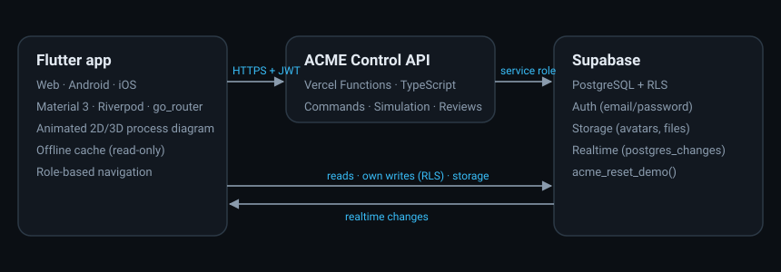

# ACME Control

Industrial monitoring and control for **water treatment plants**: a Flutter app (web, Android, iOS) with a dark HMI-style interface, a TypeScript API on Vercel that executes commands and runs the process simulation, and Supabase for PostgreSQL, email/password auth, file storage and realtime updates.



| Layer | Technology |
| --- | --- |
| App | Flutter 3.47 / Dart 3.13, Material 3, Riverpod 3, go_router 18, fl_chart |
| API | TypeScript, Vercel Functions (Web `Request → Response` handlers), zod, pnpm |
| Backend | Supabase: PostgreSQL 17 + RLS, Auth (email/password, PKCE), Storage, Realtime |

---

## What's inside

**Pages**: Login · Forgot / reset password · Plants · Process view (animated 2D/3D diagram) · Equipment (+ detail) · Alarms (open + history) · Trends · Commands · Setpoints (+ proposals) · Maintenance (+ work order detail, attachments) · Shift handover · Simulation (scenarios, advance, event log, integrations, reset) · Search · Profile · Settings.

**Process model** (identical topology in both demo plants):

```
River ─XV-101─▶ [T-101 Raw water] ─P-101/P-102─XV-102─▶ [T-102 Clearwell] ─P-201─XV-201─▶ Network
```

* Tanks fill and drain from a mass balance (inflow − outflow), with diurnal network demand.
* **AUTO** logic with hysteresis: inlet valve closes at the T-101 high setpoint, duty/standby transfer pumps stop on T-101 low or T-102 high, distribution pump stops on T-102 low.
* **Interlocks**: a pump does not run when its suction tank is empty (`interlocked`) or when it is in maintenance (`locked_out`). Faulted pumps trip; the standby takes over in AUTO.
* Valves travel at 20 %/s (`opening` / `closing`); closing a discharge valve on a running pump deadheads it (high-pressure alarm).
* Every asset shows **requested state vs actual state**; commands report `completed`, `in_progress`, `blocked` (interlock) or `rejected` (AUTO mode / role).
* ISA-18.2-style alarm lifecycle: active → acknowledged → closed, or active → cleared-unacknowledged → closed.

**Roles** (navigation adapts to each):

| Role | Can do |
| --- | --- |
| Operator | Operate pumps/valves (AUTO/MANUAL, start/stop, open/close), acknowledge alarms, write handovers, request maintenance, run the simulation |
| Engineer | Trends, **propose** setpoint changes, plan maintenance, scenarios, reset demo data (no command console) |
| Supervisor | Everything, **approve/reject** setpoint proposals (not their own), acknowledge handovers |
| Maintenance | Work orders, **lockout/tagout** (isolates equipment in the process), attachments, handovers |

**Mobile**: vertical diagram layout, bottom tabs *Plant · Alarms · Assets · More*, bottom-sheet forms with large touch targets and numeric keyboards. Live updates pause when the app goes to the background and resume on return. When offline, the last received data is shown read-only (with a banner) and every control action is disabled until the connection returns.

**Simulated integrations** (no external calls): SMS paging of critical alarms, SAP PM-style CMMS work-order sync, process-historian uploads and email notifications — all written to `integration_log` and shown on the Simulation page.

### Demo accounts

Created by `pnpm seed:users` (password from `DEMO_PASSWORD`, default `AcmeDemo!2026`):

| Email | Role |
| --- | --- |
| `operator@acme-control.test` | Operator — Olivia Carter |
| `engineer@acme-control.test` | Engineer — Ethan Brooks |
| `supervisor@acme-control.test` | Supervisor — Sofia Ramirez |
| `maintenance@acme-control.test` | Maintenance — Marcus Lee |

Demo data: **North Valley WTP** (Cedar Falls, OR) and **Harbor Point WTP** (Port Halden, ME), 15 assets each, 8 setpoints each, 12 h of trend history, alarms, 5 work orders (P-102 at Harbor Point is locked out for a seal replacement), handovers, pending setpoint proposals, events and integration messages.

---

## Repository layout

```
supabase/
  migrations/      schema, RLS + storage + realtime, demo-data generator (acme_reset_demo)
  seed.sql         runs acme_reset_demo()
  config.toml      local Supabase CLI configuration
api/               TypeScript API (Vercel project root)
  api/             Vercel functions — one file per endpoint
  src/sim/         simulation engine (pure), alarm tracker, types
  src/services/    simulation, commands, setpoints/maintenance/scenarios, simulated integrations
  src/lib/         auth (JWT + role), HTTP helpers, Supabase admin client
  src/dev-server.ts  local server that serves /api/* like Vercel
  scripts/         seed-users.ts, reset-demo.ts
  test/            engine + database/RLS tests (vitest, PGlite)
app/               Flutter app
  lib/core/        config, theme, router, formatters, shared widgets
  lib/data/        models, services (API client, cache, connectivity), repositories (Supabase access)
  lib/features/    screens + feature widgets (auth, shell, process, equipment, alarms, …)
  env/             dart-define examples
  scripts/vercel-build.sh  builds the web app on Vercel
```

### API endpoints

All endpoints expect `Authorization: Bearer <Supabase access token>`; the API verifies the token and the caller's role.

| Method & path | Roles | Purpose |
| --- | --- | --- |
| `GET /api/health` | public | Liveness |
| `POST /api/commands` | operator, supervisor | `{plantId, equipmentId, action: start\|stop\|open\|close\|set_auto\|set_manual}` |
| `POST /api/simulation/tick` | any | Advance the live simulation to "now" (called every few seconds by foreground clients) |
| `POST /api/simulation/advance` | operator, engineer, supervisor | `{plantId, minutes}` fast-forward (1–240 min) |
| `POST /api/simulation/scenario` | operator, engineer, supervisor | `{plantId, scenarioId}` |
| `POST /api/simulation/control` | operator, engineer, supervisor | `{plantId, autoRun}` pause / resume |
| `POST /api/simulation/reset` | engineer, supervisor | Restore all demo data |
| `POST /api/setpoints/propose` | engineer, supervisor | `{setpointId, proposedValue, reason}` |
| `POST /api/setpoints/review` | supervisor | `{proposalId, decision: approve\|reject, note}` |
| `POST /api/maintenance/lockout` | maintenance, supervisor | `{workOrderId, apply}` |
| `POST /api/integrations/cmms-sync` | any | Push a work order to the simulated CMMS |
| `GET /api/integrations/status` | any | Simulated external system health |

Simulation runs use optimistic concurrency (`plant_state.tick`), so several open clients never double-apply a step.

---

## Run locally

### Prerequisites

* Flutter **3.47+** (`flutter doctor`), Node.js **22+**, pnpm **10+**
* Docker Desktop (for the local Supabase stack) — or a Supabase cloud project
* Android Studio (Android) / Xcode on macOS (iOS) for native builds

### 1. Database (local Supabase)

```bash
npx supabase start
```

This applies `supabase/migrations/*` and `supabase/seed.sql`. Note the printed **API URL**, **Publishable key** and **Secret key** (service role). Reset everything later with `npx supabase db reset`.

Password-recovery emails are captured locally by Mailpit at http://127.0.0.1:54324.

### 2. API

```bash
cd api
pnpm install
cp .env.example .env
```

Edit `api/.env`: `SUPABASE_URL=http://127.0.0.1:54321` and `SUPABASE_SERVICE_ROLE_KEY=<secret key>`.

```bash
pnpm seed:users
```

```bash
pnpm dev
```

The API listens on http://localhost:3001 (`GET /api/health`). Run the tests with `pnpm test` and type-check with `pnpm typecheck`.

### 3. Flutter app

```bash
cd app
cp env/local.example.json env/local.json
```

Put the local publishable key into `env/local.json`, then:

```bash
flutter pub get
```

```bash
flutter run -d chrome --web-port 8080 --dart-define-from-file=env/local.json
```

To test a release build instead: `flutter build web --release --dart-define-from-file=env/local.json` then `node scripts/serve-web.mjs 8080` (static server with SPA fallback).

On an Android emulator use `http://10.0.2.2:54321` / `http://10.0.2.2:3001` instead of `127.0.0.1` / `localhost` in the env file. Tests: `flutter test`.

---

## Supabase cloud project (shared by web and mobile)

1. Create a project at https://supabase.com and copy the project ref.
2. Apply schema and demo data:
   ```bash
   npx supabase link --project-ref YOUR-PROJECT-REF
   ```
   ```bash
   npx supabase db push --include-seed
   ```
3. **Authentication → URL configuration**: Site URL `https://<your-web-app>.vercel.app`; add redirect URLs `https://<your-web-app>.vercel.app/reset-password` and `io.acmecontrol.app://reset-callback`.
4. **Authentication → Emails**: configure custom SMTP for production email delivery (the built-in sender is rate-limited).
5. Create the demo users: set `SUPABASE_URL` / `SUPABASE_SERVICE_ROLE_KEY` of the cloud project in `api/.env` and run `pnpm seed:users`.

Web, Android and iOS all use the same `SUPABASE_URL` and anon/publishable key, so they share data, users and realtime updates.

---

## Deploy to Vercel

### API

```bash
cd api
npx vercel link
```

```bash
npx vercel env add SUPABASE_URL production
```

```bash
npx vercel env add SUPABASE_SERVICE_ROLE_KEY production
```

```bash
npx vercel env add ALLOWED_ORIGINS production
```

```bash
npx vercel deploy --prod
```

Project settings: Root Directory `api`, Framework preset **Other**, Node.js 22. Functions are in `api/api/**`. Check `https://<api>.vercel.app/api/health`.

### Web app

**Option A — prebuilt (fastest):**

```bash
cd app
flutter build web --release --dart-define-from-file=env/prod.json
```

```bash
npx vercel deploy --prod
```

`app/vercel.json` serves `build/web` with SPA rewrites (needed for `/reset-password` links). When asked for build settings, set the build command to empty so Vercel only uploads `build/web`.

**Option B — build on Vercel from Git:** Root Directory `app`, Build Command `bash scripts/vercel-build.sh`, Output Directory `build/web`, Install Command empty. Add `SUPABASE_URL`, `SUPABASE_ANON_KEY`, `API_BASE_URL`, `WEB_APP_URL` (and optionally `DEMO_PASSWORD`) as environment variables. The script installs the Flutter SDK and builds with those values.

Afterwards, add the web URL to the API's `ALLOWED_ORIGINS` and to Supabase's redirect URLs.

---

## Native packages

Create `app/env/prod.json` from `env/env.example.json` with your cloud values.

### Android

```bash
flutter build apk --release --dart-define-from-file=env/prod.json
```

```bash
flutter build appbundle --release --dart-define-from-file=env/prod.json
```

Outputs: `build/app/outputs/flutter-apk/app-release.apk` and `build/app/outputs/bundle/release/app-release.aab`. For Play Store upload, create a keystore and configure `android/key.properties` + `signingConfigs` (see https://docs.flutter.dev/deployment/android). The application id is `io.acmecontrol.acme_control`; the password-recovery deep link `io.acmecontrol.app://reset-callback` is declared in `AndroidManifest.xml`.

### iOS (macOS + Xcode)

```bash
cd ios && pod install && cd ..
```

```bash
flutter build ipa --release --dart-define-from-file=env/prod.json
```

Open `ios/Runner.xcworkspace` once to select your Team and bundle identifier under *Signing & Capabilities*. The URL scheme `io.acmecontrol.app` is registered in `Info.plist`. Upload `build/ios/ipa/*.ipa` with Transporter or Xcode Organizer.

---

## Using the demo

1. Sign in as **operator** → Process view. Click **P-101**, switch it to **MANUAL**, press **Stop**: the standby pump P-102 starts in AUTO. Close **XV-101** and watch T-101 drain.
2. Simulation page → activate **Low raw-water inflow**, then **Advance +1 hour**: T-101 empties, transfer pumps show *Requested: Running · Actual: Interlocked* and alarms appear (also paged via the simulated SMS gateway).
3. Sign in as **engineer** → Setpoints → **Propose change**. Sign in as **supervisor** → Setpoints → Proposals → **Approve**; the control logic uses the new value immediately.
4. Sign in as **maintenance** → Maintenance → WO-24003 (Harbor Point) → **Release lockout** returns P-102 to service; **Apply lockout** on another order locks the pump out — start requests are then blocked.
5. Reload the browser: everything is persisted in Supabase. Turn off the network: the app shows the last data read-only and disables controls.
6. Simulation → **Reset demo data** restores the initial state.

## Security notes

* The service-role key is only used by the API (server side). The app ships only the anon/publishable key.
* RLS: authenticated users can read plant data; commands, simulation, setpoint approval and lockout go through the API, which checks roles. Users can update only non-privileged columns of their own profile (not `role`). Operators can only create maintenance *requests*. Handovers must be acknowledged by someone other than the author. Proposals cannot be approved by their author.
* Storage: `avatars` (public read, owner write in `<uid>/`), `maintenance-files` (private, signed URLs).
